# DUET: a voice agent you can interrupt, that acts on what you finally meant

**Samsung PRISM GenAI Hackathon 3.0 · Theme 05: Interruptible Real-Time Agents · Team SE7EN, SRM Institute of Science and Technology**

https://github.com/user-attachments/assets/258e337e-e1b3-4544-b78d-f4f68e500f93

<p align="center">
  <b><a href="https://github.com/tannnmayy/DUET-SAMSUNGPRISM-HACKATHON-TEAM-SE7EN/raw/main/docs/round2/deck/duet_demo.mp4">▶ Watch the full live demo</a></b> in 1080p (2:58, MP4, 70 MB) ·
  <b><a href="docs/round2/deck/DUET_Round2_Deck.pdf">Pitch deck (PDF)</a></b> ·
  <a href="docs/round2/deck/DUET_Round2_Deck.html">Animated deck (HTML)</a> ·
  <a href="docs/round2/DEMO_FILM_NOTES.md">How the film was cut</a>
</p>

<p align="center"><sub>The live demo on a real Galaxy S24, five scenarios from three views kept in sync. At 1:17: <i>"Could you please text Gupta Hostel that I'll be there for dinner at 9, and also set an alarm for 8:50 today. No, no, no, wait, it's okay. Set an alarm for 8:30."</i> DUET sends the text and sets 8:30. The 8:50 alarm never runs.</sub></p>

---

People interrupt, hesitate and correct themselves mid-sentence. A voice agent that acts on the first pause gets it wrong
exactly there:

> **You:** "Set an alarm for 6:30... no, make it 7."
>
> **A typical voice agent:** `set_alarm(06:30)` ran, `set_alarm(07:00)` ran. *Two alarms; you wake up at 6:30.*
>
> **DUET:** `set_alarm(06:30)` **never ran**, `set_alarm(07:00)` **done, once.** *"Sure. Alarm set for 7 in the morning."*

DUET is a full-duplex voice agent for Galaxy phones. It listens while it talks, stops within a fifth of a second when you
talk over it, and never acts on words you have taken back. Every action passes one **coordinator** that decides *when
acting is allowed*, runs it **once**, and says it is done only after the phone confirms it.

| | |
|---|---|
| **Live on a phone** | A Samsung Galaxy S24 app in three modes (Assistant, Care, Drive): 34 real phone actions, a real SmartThings home, Google Maps, web answers, weather, places and time |
| **Two minds** | A **fast mind**, Gemma 4 E2B on our laptop GPU, decides simple actions in about 0.25 s. A **cloud mind**, Gemma 4 26B-A4B through Google's API, takes questions, explanations and anything unclear |
| **One coordinator** | Epochs, a commit gate and an exactly-once ledger, shared by both minds. A plan made on words you have since changed never runs |
| **It hears how you say it** | A tone channel reads acoustics and meaning together: an unsure value ("4:30, I think") is asked back before it runs, and a shouted "no" stops an action |
| **Benchmark** | Full-Duplex-Bench v3, all 100 recordings: **Pass@1 0.81** against GPT-Realtime's 0.600, **0 interruptions** of the user, 100% turn-taking |
| **Tested** | 365 unit tests; a 66-scenario spoken suite with **0 stale and 0 duplicate actions**; failure drills for every part that can go down |

**Contents:**
[the pitch deck](#the-pitch-deck) ·
[how DUET works](#how-duet-works) ·
[the coordinator](#the-coordinator-when-an-action-may-run) ·
[numbers](#numbers) ·
[run it](#run-duet-on-a-galaxy-phone) ·
[reproduce the benchmark](#reproduce-the-benchmark) ·
[tests](#how-it-is-tested) ·
[limits](#honest-limits) ·
[repository map](#repository-map) ·
[documentation](#documentation)

## The pitch deck

The Round 2 presentation, as given to the jury: eight slides and an appendix. The
**[PDF](docs/round2/deck/DUET_Round2_Deck.pdf)** has every slide at its last build. The
**[HTML deck](docs/round2/deck/DUET_Round2_Deck.html)** is the animated original: download the `deck/` folder and open
it in Chrome (**F** full screen, **→** next build, **N** speaker notes). Its last slide plays the film.

<details open>
<summary><b>Slides 1–8</b> (click any slide for full size)</summary>
<br>

**1 · DUET**
<a href="docs/round2/deck/slides/01_hook.png">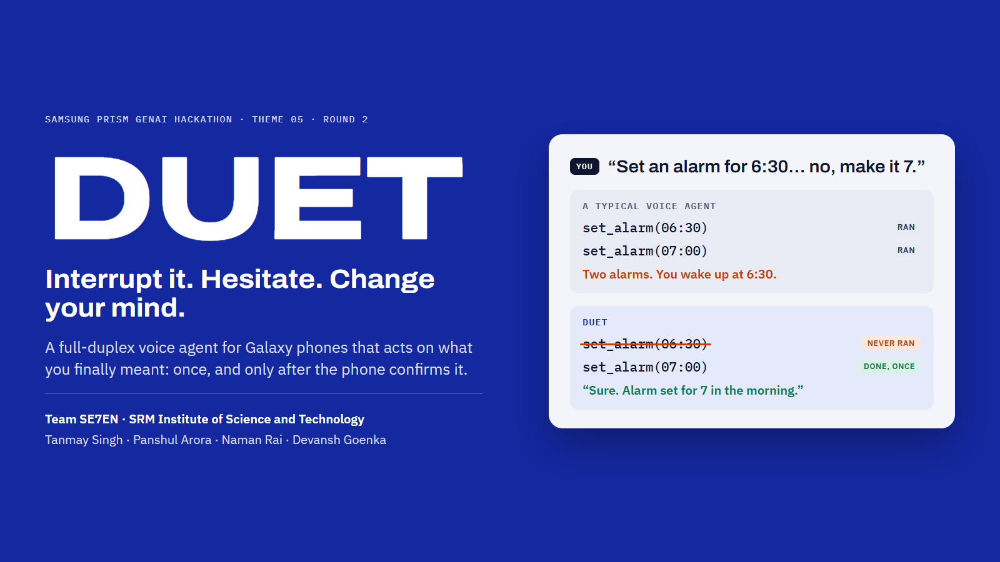</a>

**2 · The problem**
<a href="docs/round2/deck/slides/02_problem.png">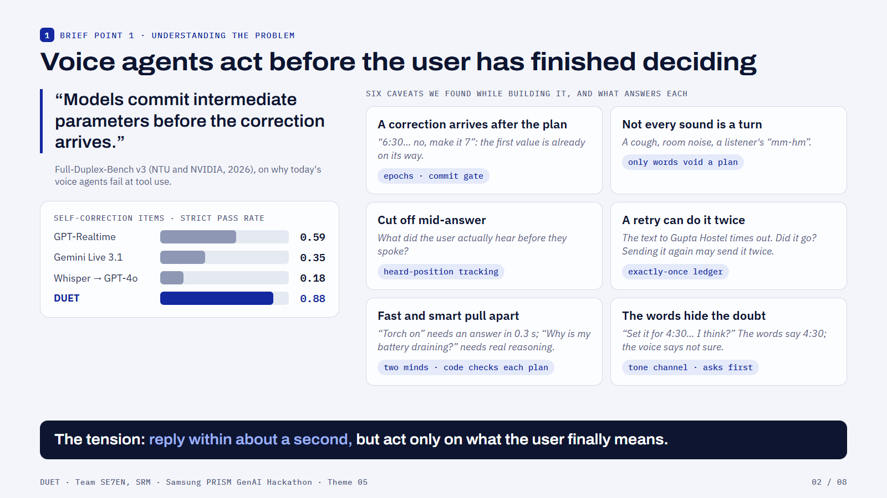</a>

**3 · One conversation through DUET**
<a href="docs/round2/deck/slides/03_flow.png">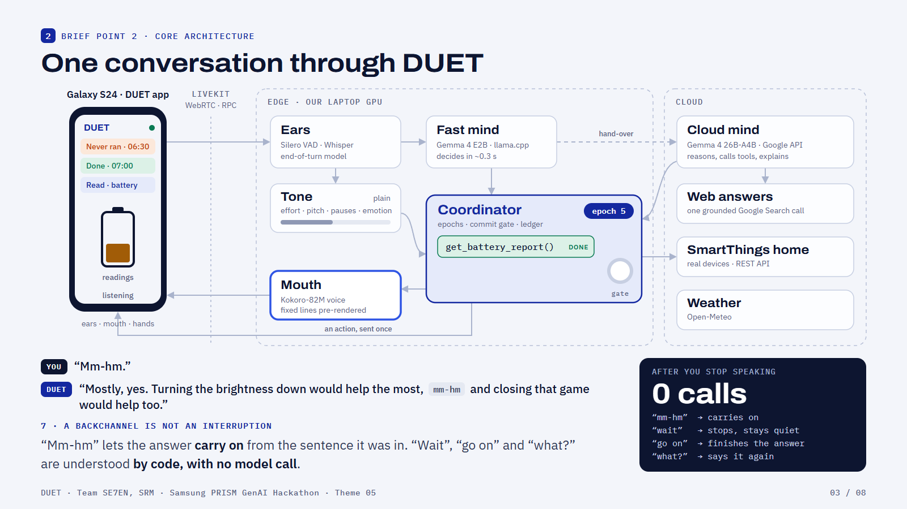</a>

**4 · The coordinator**
<a href="docs/round2/deck/slides/04_coord.png">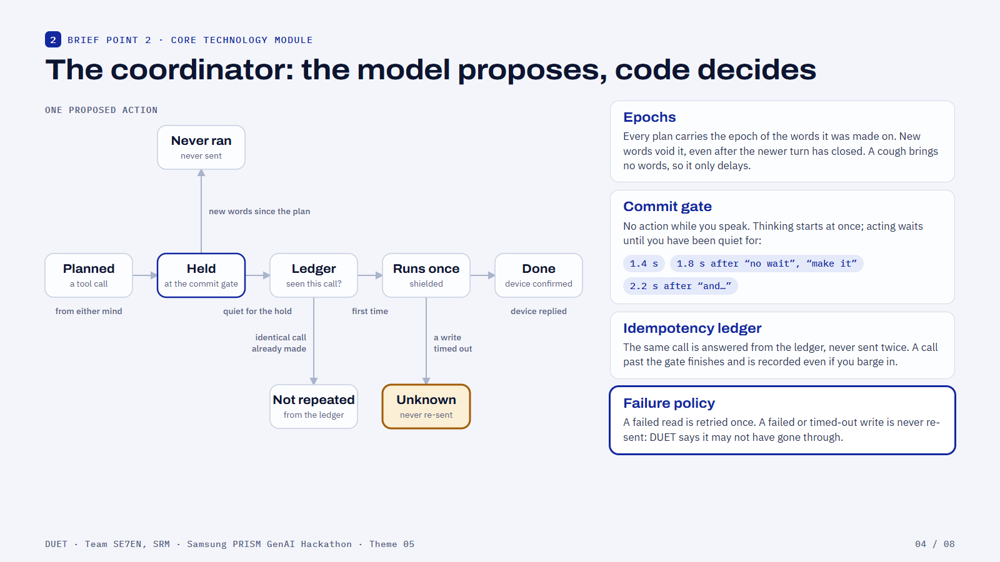</a>

**5 · Semantics and acoustics: how DUET hears tone**
<a href="docs/round2/deck/slides/05_tone.png">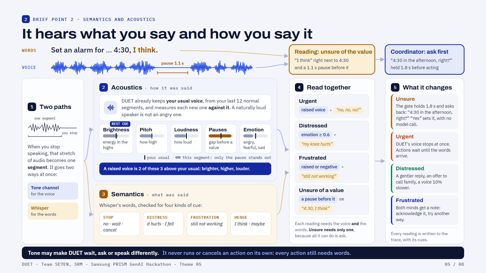</a>

**6 · On a Galaxy today**
<a href="docs/round2/deck/slides/06_galaxy.png">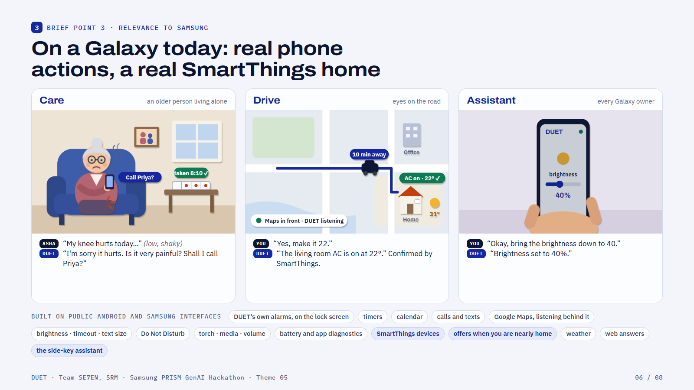</a>

**7 · Vision and roadmap**
<a href="docs/round2/deck/slides/07_roadmap.png">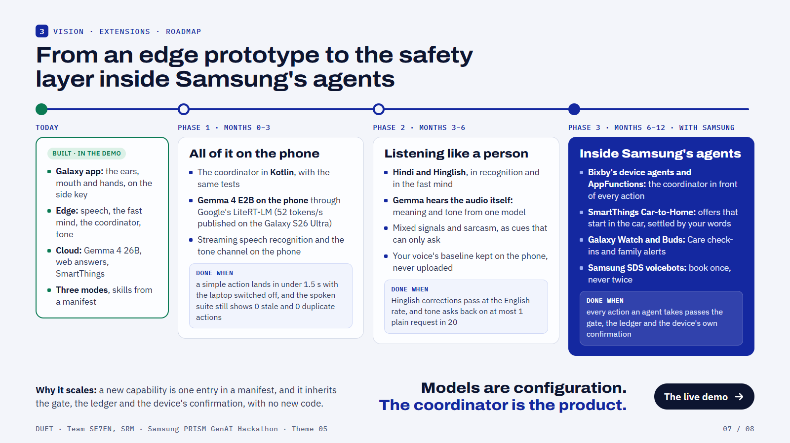</a>

**8 · The live demo film** ([play it](https://github.com/tannnmayy/DUET-SAMSUNGPRISM-HACKATHON-TEAM-SE7EN/raw/main/docs/round2/deck/duet_demo.mp4))
<a href="https://github.com/tannnmayy/DUET-SAMSUNGPRISM-HACKATHON-TEAM-SE7EN/raw/main/docs/round2/deck/duet_demo.mp4">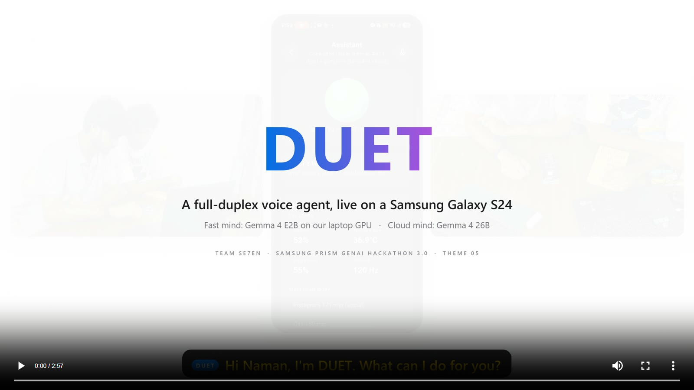</a>

</details>

<details>
<summary><b>Appendix A1–A6</b>: latency, the fast mind, tone, testing, the benchmark, the landscape</summary>
<br>

| | |
|---|---|
| <a href="docs/round2/deck/slides/10_a-latency.png">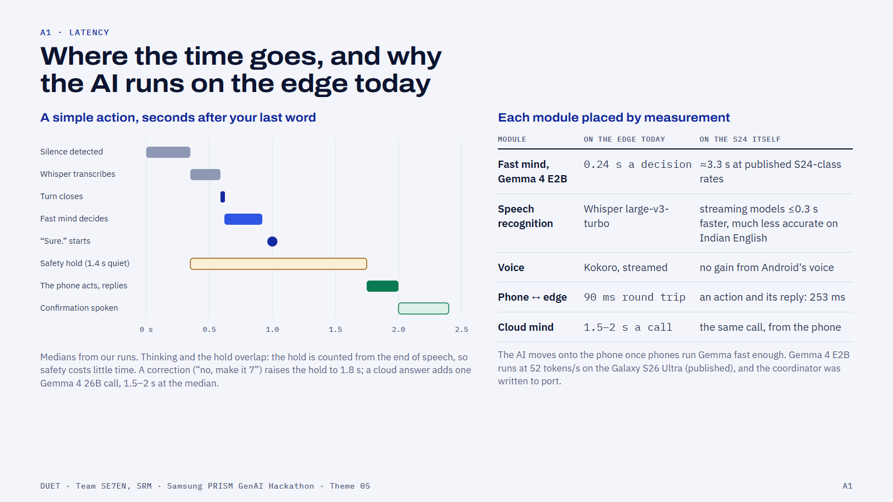</a><br>**A1 · Latency** | <a href="docs/round2/deck/slides/11_a-fast.png">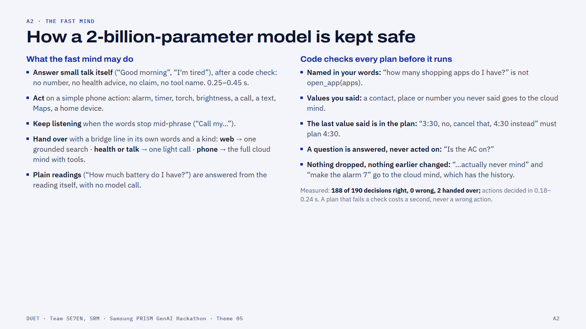</a><br>**A2 · The fast mind** |
| <a href="docs/round2/deck/slides/12_a-tone.png">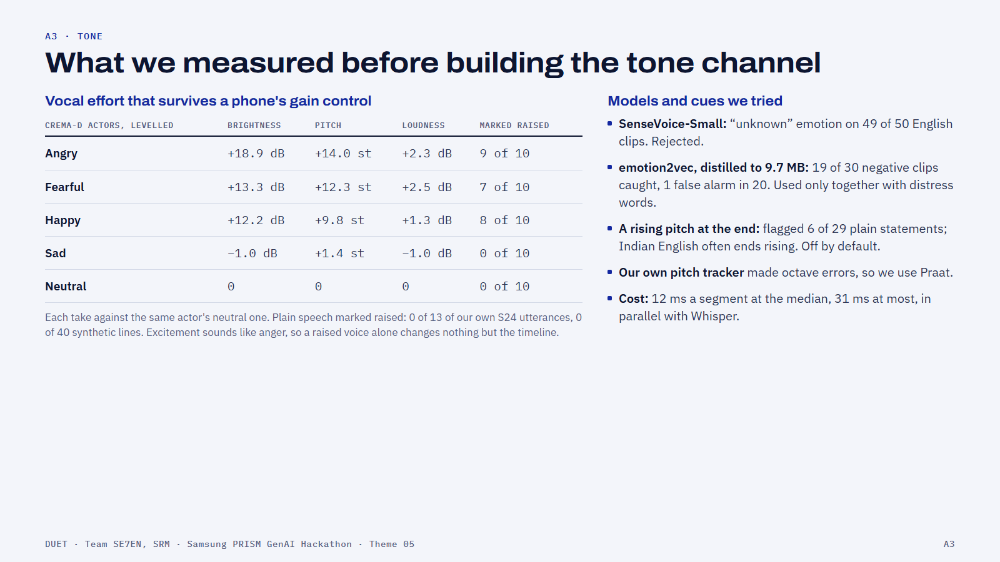</a><br>**A3 · Tone** | <a href="docs/round2/deck/slides/13_a-tests.png">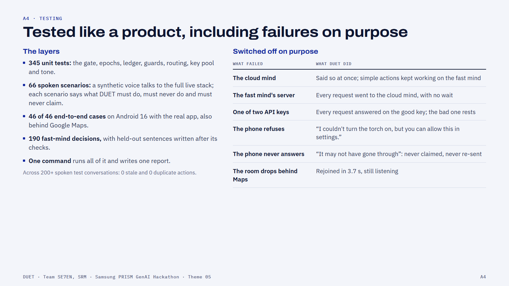</a><br>**A4 · Testing** |
| <a href="docs/round2/deck/slides/14_a-fdb.png">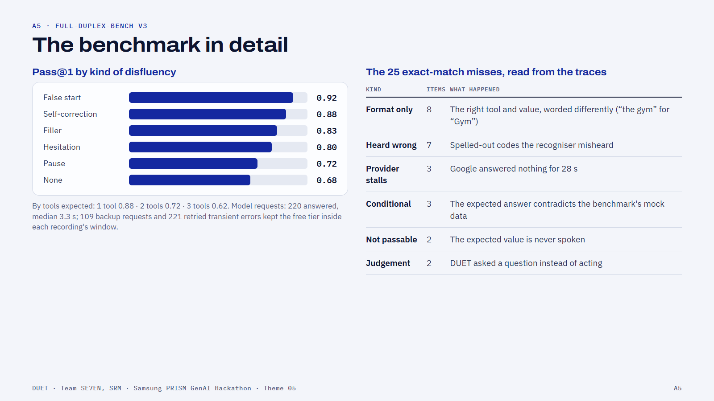</a><br>**A5 · The benchmark** | <a href="docs/round2/deck/slides/15_a-land.png">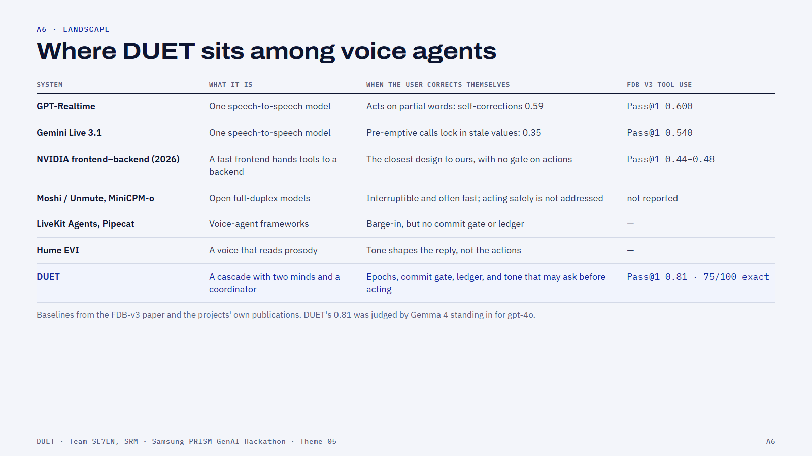</a><br>**A6 · The landscape** |

</details>

## How DUET works

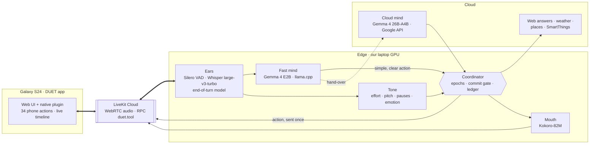

- **The ears** turn the phone's audio into words and decide when a turn has ended. They never decide what to do.
- **The fast mind** (Gemma 4 E2B, 2B parameters, on llama.cpp) looks at every request first and decides in about
  0.25 s. It may act only on a simple, clear request: the action and its values are named in your own words, the last
  value you said is the one in its plan, and it is not a question. Deterministic code checks each of these. Anything
  else (a question, an explanation, the web, the weather, care, anything that wavers) is handed to the cloud mind.
- **The cloud mind** (Gemma 4 26B-A4B) sees the *open request*: everything you have said since the last answer you
  actually heard, so a correction is always read with what it corrects. It runs its own tool loop and answers from the
  tools' results. Web questions take one grounded Google Search call.
- **The coordinator** owns every action of both minds (below). Nothing runs while you speak, a plan your later words
  overtook never runs, and nothing runs twice.
- **The tone channel** measures each segment against *your usual voice* (the averages of your last 12 normal segments)
  and reads the words for hedges and distress. It can make DUET wait or ask; it can never act on its own.
- **The mouth** confirms an action from the device's own reply ("Alarm set for 7 in the morning."), with no model call.
  An action the device has not confirmed is said as "sent", and one whose outcome is unknown as "may not have gone
  through".
- **Talking over DUET** stops it in 0.21 s (LiveKit's adaptive interruption). A backchannel ("mm-hm") lets it carry on
  from the sentence it was in; "wait", "go on" and "what?" are understood by code, with no model call.

### One turn, with a self-correction

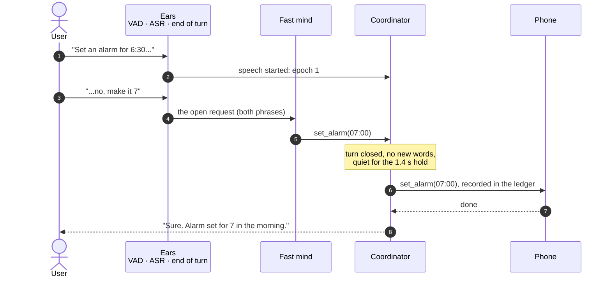

Had the user spoken again before the hold ran out ("...actually, 7:15"), the plan would have waited at the gate while
they spoke and been dropped the moment their new words arrived. The next turn re-reads everything and plans again. A
cough or room noise, which brings no words, only delays the call.

### The coordinator: when an action may run

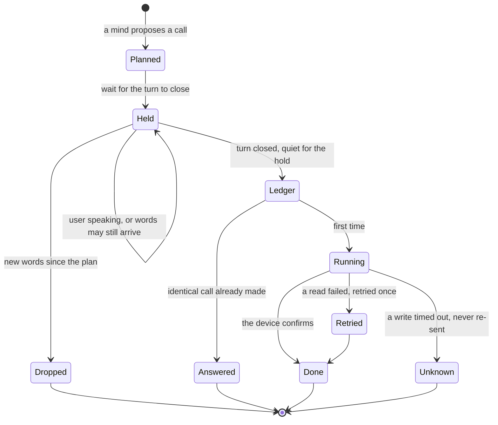

| Mechanism | What it guarantees |
|---|---|
| **Epochs** | Every call carries the epoch of the words its plan was made on. Once the user says anything new, older plans are void, even after the newer turn has closed |
| **Commit gate** | An action runs only after the turn has closed and the user has been quiet for the hold: **1.4 s** on the phone (1.1 s on the benchmark), **1.8 s** after a correction word ("no wait", "actually") or an unsure tone, **2.2 s** when the last words leave a sentence open ("and...", "um") |
| **Exactly-once ledger** | An identical call already made in the conversation is answered from the ledger: a state-changing action never happens twice, even when the user barges in mid-call |
| **Failure policy** | A failed read is retried once. A failed or timed-out write is never blindly re-sent: it is recorded as unknown and the user is told |
| **Guards around the model** | Nothing is done on a sentence cut off mid-phrase ("Call my") or while the user wavers ("6:30, or maybe 7"); a time without AM or PM means the next one; an unasked call, text or home change asks first |

The full design, with the reasoning behind every threshold: [docs/ARCHITECTURE.md](docs/ARCHITECTURE.md).

## Numbers

### On the phone (Round 2)

Measured from the moment you stop speaking, on this laptop's stack (RTX 3060 Laptop, 6 GB), LiveKit Cloud and Google's
free Gemma tier.

| What | Time |
|---|---|
| The fast mind decides a simple action | **0.23 s** (190 decisions: 188 right, **0 wrong**, 2 handed over) |
| First words ("Sure.") | **about 1.0 s** p50 |
| A simple action done and confirmed (alarm, torch, a light) | **about 2.4 s** p50, including the 1.4 s safety hold |
| DUET stops when you talk over it | **0.21 s** after your speech begins |
| A cloud-mind answer | about 2 s p50; weather and web 4–7 s |
| Rejoining after a dropped room, behind Google Maps | 3.7 s |
| The spoken suite on the final code (67 runs, 26 Oct) | first word 1.58 s, action 2.15 s, answer 2.02 s (p50) |

Where the time goes, the fast and cloud minds compared, and what changes on the phone itself: appendix slide
[A1](docs/round2/deck/slides/10_a-latency.png) and [docs/ROUND2_TEST_REPORT.md](docs/ROUND2_TEST_REPORT.md).

### Full-Duplex-Bench v3 (Round 1)

All 100 recordings, streamed in real time through the benchmark's own runner and scored by its own scripts. The complete
record of the run, with every trace and log, is in [`results/reported/gemma4_final_run`](results/reported/gemma4_final_run).

| System | Pass@1 | Tool selection | Argument accuracy | Response quality | Turn-take | Task latency | Interruptions |
|---|---|---|---|---|---|---|---|
| **DUET, Gemma 4 26B-A4B (ours)** | **0.81** | **0.915** | **0.850** | **0.730** | **100%** | **14.44 s** | **0%** |
| GPT-Realtime (paper) | 0.600 | 0.876 | 0.680 | 0.792 | 96.0% | 6.89 s | 13.5% |
| Gemini Live 3.1 (paper) | 0.540 | 0.817 | 0.588 | 0.718 | 78.0% | 4.25 s | 19.2% |
| Cascaded Whisper → GPT-4o → TTS (paper) | 0.450 | 0.803 | 0.562 | 0.600 | 100% | 10.12 s | 33.0% |

Higher is better, except latency and interruptions. Scored on our laptop (RTX 3060, Windows) with two disclosed
stand-ins: the LLM judge is Gemma 4 26B-A4B answering the official gpt-4o prompts unchanged, and faster-whisper
transcribes DUET's own speech in place of the Linux-only Parakeet (this affects response quality and latency, not the
tool metrics). With no judge at all, by exact match, DUET passes 75 of 100. The benchmark's task latency includes the
safety hold, the free tier's request time and the recorder's own constant offset; it is not the phone's latency above.
How we measured, the remaining misses and each kind of disfluency: [docs/RESULTS.md](docs/RESULTS.md).

## Run DUET on a Galaxy phone

DUET for Galaxy runs as an Android app on the phone and a stack on a laptop with an NVIDIA GPU (6 GB is enough). The
full, checked set-up from a fresh clone, Windows laptop and Galaxy S24, is
**[docs/ROUND2_SETUP.md](docs/ROUND2_SETUP.md)**. In short:

```bash
python -m venv .venv && .venv/Scripts/pip install -r requirements.txt     # Python 3.11 (.venv/bin on Linux)
# .env.local:   GOOGLE_API_KEYS=key1,key2,key3   and, optionally, SMARTTHINGS_TOKEN=...
# .env.livekit: LIVEKIT_URL, LIVEKIT_API_KEY, LIVEKIT_API_SECRET (a LiveKit Cloud project)
LLAMA_SERVER=/path/to/llama-server FAST_MODEL=/path/to/gemma-4-E2B-it-Q4_0.gguf \
  bash scripts/galaxy_demo.sh                 # the fast mind, the agent, the token server on :8787
curl http://localhost:8787/api/health         # fast mind, cloud mind, SmartThings, LiveKit, tone: all ok
```

Then build and install the app ([app/README.md](app/README.md)), set its server address to the laptop, and talk.
`bash scripts/galaxy_stop.sh` stops everything. The demo-day checklist and script are in
[docs/ROUND2_DEMO.md](docs/ROUND2_DEMO.md).

| Mode | For whom | What it does |
|---|---|---|
| **Assistant** | Every Galaxy owner | Alarms and timers corrected mid-sentence; battery troubleshooting from the phone's real readings; apps, settings, the torch, Maps, calls and texts; the weather, web answers, places and time; the SmartThings home |
| **Care** | An older person living alone, and their family | Medicines with a double-dose guard, calls and messages to family, reminders, a daily check-in, a family alert |
| **Drive** | A driver, eyes on the road | A destination changed mid-sentence, arrival-time messages, the car's climate, the home from the car, all while Google Maps is in front; nearly home, DUET offers the AC from SmartThings' real state |

A new phone capability is one entry in [`app/www/skills.json`](app/www/skills.json), with no code: it inherits the gate,
the ledger and the device's confirmation.

## Reproduce the benchmark

```bash
export GOOGLE_API_KEYS=key1,key2        # or GOOGLE_API_KEY=key (also read from .env.local)
bash scripts/doctor.sh                  # optional: is this machine ready? (checks the keys too)
bash reproduce.sh --only travel_19_695bd157114f0d2317f88617   # a two-minute check
bash reproduce.sh --force               # all 100 recordings, then the three official evaluations
```

- **Machine:** Linux x86_64, an NVIDIA GPU with about 8 GB free and a CUDA 12.x or 13.x driver, 16 GB of RAM or more,
  `git`, `curl`, internet access, about 30 GB of disk. No sudo, no system Python: a pinned `uv` supplies Python 3.11;
  ffmpeg and the LiveKit server are fetched into `third_party/`.
- **Time:** about two hours for all 100 recordings (each is streamed in real time), plus about 15 minutes of installation
  on the first run.
- **What it runs:** the benchmark's **unmodified** `run_tool_benchmark_all_released.py --provider duet`, then its three
  evaluation scripts with `--use-llm`, and prints the headline numbers and the GPU's peak memory.
- **The benchmark path is separate from the phone's.** Everything the phone added is a hook whose default is the
  benchmark's behaviour, and `tests/test_voice_integrity.py` fails if any value the benchmark expects appears in the agent.

<details>
<summary><b>API keys, Docker, network hosts, running under your own harness</b></summary>

### API keys

No key is included in this repository. Set them in the environment or in `.env.local` at the repository root
(git-ignored).

| Variable | Purpose | Required |
|---|---|---|
| `GOOGLE_API_KEY` | Gemma 4 through Google's API. Create one at [aistudio.google.com](https://aistudio.google.com) **in a project without billing**: Google serves Gemma free of charge on the free tier. The preflight tests every key before the run starts and names any problem | **Yes** (or the next line) |
| `GOOGLE_API_KEYS` | Several keys, comma-separated, each from a different project without billing. Their per-minute limits add up; two or three are recommended | Recommended |
| `OPENAI_API_KEY` | The benchmark's gpt-4o judge (argument and response scoring, key-information latency) | Optional |
| `LIVEKIT_URL`, `LIVEKIT_API_KEY`, `LIVEKIT_API_SECRET` | A LiveKit Cloud project instead of the local LiveKit server. The phone needs one: put them in `.env.livekit` | Optional |
| `SMARTTHINGS_TOKEN` | The phone's SmartThings home (a personal access token; without it the app's simulated home is used) | Optional |

### In a container

The [`Dockerfile`](Dockerfile) runs the same `reproduce.sh` on a clean Ubuntu 22.04 image, adding only the tools the
script expects (git, curl, xz). It needs the NVIDIA Container Toolkit on the host.

```bash
docker build -t duet .
docker run --rm --gpus all --shm-size 8g -e GOOGLE_API_KEYS=key1,key2 \
  -v duet-cache:/duet/third_party -v "$PWD/results/live:/duet/results/live" \
  duet --only travel_19_695bd157114f0d2317f88617        # or --force for all 100 recordings
```

### Network access

For a machine behind a firewall, these are every host the reproduction contacts:

| Host | What for | When |
|---|---|---|
| `generativelanguage.googleapis.com` | Gemma 4, the language model | Every run |
| `api.openai.com` | The official gpt-4o judge, when `OPENAI_API_KEY` is set | Evaluation |
| `pypi.org`, `files.pythonhosted.org` | Python packages, from the lock files | First run |
| `huggingface.co` and its download hosts (`*.huggingface.co`, `*.hf.co`) | The speech models and the benchmark's Parakeet recognizer | First run |
| `github.com` and its download hosts (`objects.githubusercontent.com`, `release-assets.githubusercontent.com`) | Full-Duplex-Bench, the LiveKit server, ffmpeg, Python 3.11 builds, one spaCy model | First run |
| `astral.sh`, `releases.astral.sh` | The pinned `uv`, if it is not installed | First run |
| `drive.usercontent.google.com` | The benchmark audio, unless `FDB_DATA_DIR` points at a copy | First run |

`bash scripts/doctor.sh` checks that the main one in each row can be reached.

### Run it under your own harness

The agent is an ordinary LiveKit worker. It joins every new room in the project (no agent name, no explicit dispatch),
so run only this worker there.

```bash
.venv/bin/python -m duet_voice.prefetch        # once: download and warm the speech models
.venv/bin/python -m duet_voice.gemma_api       # the keys reach Gemma 4 and tool calling works
.venv/bin/python -m duet_voice.agent start     # ready when the log shows "registered worker"
```

Then run the benchmark's own runner and evaluations with `--provider duet`. Tool calls go to
`/tmp/agent_tool_calls.log` in the benchmark's format. Every run writes `results/live/<time>/` (settings, summary,
the benchmark's reports, per-recording results, DUET's traces and process logs); `bench/publish_run.py` copies a run,
without audio, to [`results/reported/`](results/reported/).

</details>

## How it is tested

| Layer | How | Result |
|---|---|---|
| The code | `python -m pytest tests -q`: the coordinator's gate, epochs and ledger, the key pool, both minds' guards, tone, confirmations, the phone bridge | **365 pass** |
| The conversation | `scripts/galaxy_suite.py`: 66 spoken scenarios. A scripted voice joins a LiveKit room the way the phone does, interrupts, corrects itself, hesitates and shouts; the whole stack answers | 21 Oct: **64 of 66**, both misses real bugs, fixed and re-run. 26 Oct, final code: **62 of 67** (4 misses: Google's free tier did not answer in time; 1: "Monday" said on a Monday was read as today). Both runs: **0 stale actions, 0 duplicates** |
| The fast mind alone | `scripts/galaxy_fast_eval.py --repeat 2` | 190 decisions: 188 right, **0 wrong** |
| The phone | the real app on the Android 16 emulator: end to end in every mode (`scripts/phone_e2e.py`), resilience behind Google Maps (`scripts/phone_resilience.py`). Then the Galaxy S24, live | 46 of 46; 3 of 3 |
| Failures on purpose | the fast mind killed, the cloud cut, a bad key, every key bad, the phone refusing or not answering, the room dropped | every one survives or fails with a clear message ([report §3](docs/ROUND2_TEST_REPORT.md#3-failure-injection)) |

`python scripts/verify_all.py` runs all of it in one command and writes one dated report to `results/verify/`. The
day-long failure hunt behind these numbers, with every bug it found: [docs/ROUND2_TEST_REPORT.md](docs/ROUND2_TEST_REPORT.md).

## Honest limits

- **Not standalone yet.** The phone needs the laptop (a 6 GB NVIDIA GPU) and the internet; LiveKit Cloud and Google must
  both be up. Phase 1 of the roadmap moves the coordinator (Kotlin) and Gemma 4 E2B onto the phone.
- **Cloud answers are slower than ChatGPT Live:** about 2 s p50, weather and web 4–7 s, on Google's free tier. Simple
  actions are fast because the fast mind does them.
- **English only**, and the guards are English regular expressions. Hindi and Hinglish are Phase 2.
- **The tone thresholds come from actors and synthetic voices**; they are logged for every segment so they can be
  checked on real voices.
- **The S24 showed an extra ~2 s before the first word** on 20 Oct that the laptop and the emulator do not show; it is
  not yet explained.
- **The benchmark score uses a proxy judge** (Gemma 4 for gpt-4o); 75 of 100 by exact match with no judge.

## Repository map

```
duet_voice/              the agent
  agent.py               LiveKit entrypoint: ears, fast voice, the turn loop
  coordinator.py         epochs, commit gate, exactly-once ledger, failure policy
  thinker.py             Gemma 4 tool loop, keep-listening
  gemma_api.py           key pool, token budget, retries, backup requests, preflight
  fdb_tools.py           the 12 FDB-v3 tools over the benchmark's mock backend
  galaxy/                DUET for Galaxy: the phone agent
    agent.py             the phone agent: both minds, the gate, interruptions, the timeline
    fast.py              the fast mind and the routing between the minds
    tools.py             phone tools and their guards (cut off, undecided, unsure, consent)
    tone.py              acoustics and semantics: how it was said
    confirm.py           confirmations from the device's reply; overclaims removed
    proactive.py         offers DUET makes first (nearly home, the washer)
    skills.py            phone actions declared in app/www/skills.json
    server_tools.py      web, weather, places, time, distance
    smartthings.py       the SmartThings home
    server.py            the token server (:8787) and /api/health
app/                     the Android app: Capacitor web UI, native plugin, skills manifest
bench/                   live runner, warm-up, offline evaluators, judge adapter, reports
scripts/                 the stack, the spoken suite, phone checks, verify_all, preflight
tests/                   365 unit tests
tools/demo_video/        the scripts that cut the Round 2 demo film
docs/                    architecture, results, Round 2 set-up, demo, tests; round1/ and round2/ deliverables
results/reported/        the reported benchmark run: reports, traces and logs
results/verify/          verify_all reports
AI disclosure/           LangAI 3.0 AI disclosure form (PDF)
reproduce.sh, Dockerfile one-command benchmark reproduction
```

## Documentation

| Document | What it covers |
|---|---|
| [docs/round2/](docs/round2/README.md) | **The Round 2 deck (HTML, PDF, slide images) and the demo film**, with how to present it |
| [docs/ARCHITECTURE.md](docs/ARCHITECTURE.md) | Every component, the turn lifecycle, the coordinator, the model client, the tools, the Galaxy extension (§10) |
| [docs/ROUND2_SETUP.md](docs/ROUND2_SETUP.md) | Set it up from a fresh clone: laptop and Galaxy S24, every step with a check |
| [docs/ROUND2_DEMO.md](docs/ROUND2_DEMO.md) | The demo kit: checklist, script, drills |
| [docs/ROUND2_TEST_REPORT.md](docs/ROUND2_TEST_REPORT.md) | The failure hunt: what was tested, what broke and was fixed, the verdict, the S24 run |
| [docs/ROUND2_TONE_PLAN.md](docs/ROUND2_TONE_PLAN.md) | The tone channel: research, measurements, design, tests |
| [docs/ROUND2_CAPABILITIES.md](docs/ROUND2_CAPABILITIES.md) | Every capability of DUET for Galaxy and what it is worth for Theme 05 |
| [docs/ROUND2_PLAN.md](docs/ROUND2_PLAN.md) · [EXPANSION_PLAN](docs/ROUND2_EXPANSION_PLAN.md) · [CONVERSATION_PLAN](docs/ROUND2_CONVERSATION_PLAN.md) | The Round 2 plans, in the order they were made, with the measurements behind each decision |
| [docs/RESULTS.md](docs/RESULTS.md) | The benchmark run in detail: metrics, breakdowns, the remaining misses |
| [docs/ENGINEERING_NOTES.md](docs/ENGINEERING_NOTES.md) | How the benchmark scores, what we measured, and the decision each measurement led to |
| [docs/USE_CASE_RESEARCH.md](docs/USE_CASE_RESEARCH.md) | The research behind the Galaxy use cases |
| [docs/SAMSUNG_REQUIREMENTS.md](docs/SAMSUNG_REQUIREMENTS.md) | Each line of the Theme 05 guide and the hackathon rules, and where it is met |
| [app/README.md](app/README.md) | The app: build, install, what is real and what is simulated |
| [docs/round1/](docs/round1/README.md) | The Round 1 submission: deck, 47-page documentation, video script |
| [`AI disclosure/`](AI%20disclosure/LangAI3.0_AI_Disclosure_SE7EN.pdf) | LangAI 3.0 AI disclosure form |

**Releases.** The Round 1 submission is tag `PRISM_GENAI_HACKATHON_Y2026`; the final state of the project, after Round 2,
is tag `final-state-of-duet-a-full-duplex-interruptible-real-time-agent`.

## Team SE7EN

Tanmay Singh · Panshul Arora · Naman Rai · Devansh Goenka, SRM Institute of Science and Technology.

## References

- G.-T. Lin, C. Chen, Z. Chen, H.-y. Lee. *Full-Duplex-Bench-v3: Benchmarking Tool Use for Full-Duplex Voice Agents
  Under Real-World Disfluency.* arXiv:2604.04847, 2026. Code and data: <https://github.com/DanielLin94144/Full-Duplex-Bench> (v3).
- Gemma 4: <https://ai.google.dev/gemma> · LiveKit Agents: <https://github.com/livekit/agents> · llama.cpp:
  <https://github.com/ggml-org/llama.cpp> · faster-whisper: <https://github.com/SYSTRAN/faster-whisper> · Kokoro-82M:
  <https://huggingface.co/hexgrad/Kokoro-82M> · Silero VAD: <https://github.com/snakers4/silero-vad> · the emotion model:
  <https://huggingface.co/thomashallock/emotion2vec-web-distill>
