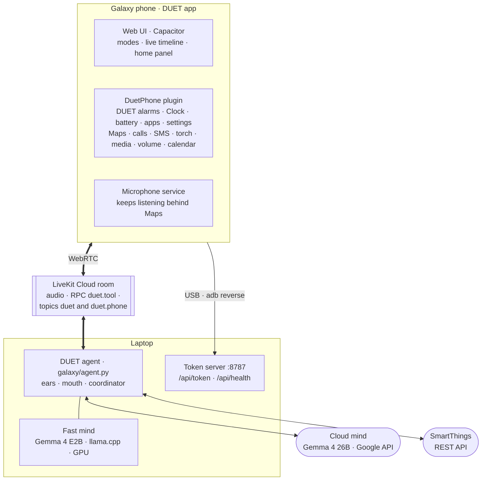

# DUET for Galaxy

DUET is a full-duplex voice agent: you can interrupt it, correct yourself mid-sentence and change your mind, and it
never acts on words you took back, never does anything twice, and never says something is done before it is. The
benchmark submission shows this on Full-Duplex-Bench v3. This app puts the same agent and the same coordinator on a
Samsung Galaxy phone, with the phone's real actions and a real SmartThings home.

| Mode | For whom | What it shows |
|---|---|---|
| **Assistant** | Every Galaxy owner | An alarm corrected mid-sentence; battery troubleshooting from the phone's real readings that you can interrupt; apps, brightness, settings, Maps, the torch, music, volume, the calendar, the weather, web answers, the SmartThings home |
| **Care** | An older person living alone, and their family | Medicines with a double-dose guard, calls and messages to family, reminders, a daily check-in, a family alert |
| **Drive** | A driver, eyes on the road | A destination changed mid-sentence, arrival-time messages, the car's climate, the home from the car, all while Google Maps is in front |

## How it works



- **Two speeds.** The fast mind (Gemma 4 E2B on the laptop's GPU) looks first and does simple, clear phone actions in
  about a second. It may act only when the user's own words name the action and its values, the last number said is in
  its plan, and the request is not a question; deterministic code checks this. Everything else (questions,
  explanations, the weather, the web, care, anything unclear or wavering) goes to the cloud mind (Gemma 4 26B).
- **One coordinator** gates every action of both minds: nothing runs while you speak or before you have been quiet for
  the hold, a plan your later words overtook never runs, and nothing runs twice.
- **Confirmed when done.** The moment the phone (or SmartThings) reports an action done, DUET says so in a few words
  ("Alarm set for 7 in the morning."), from the phone's reply, with no model call. A change the device has not
  confirmed is said as "sent", an action whose outcome is unknown as "may not have gone through".
- **Guards that hold whatever the model decides:** nothing is done on a sentence cut off mid-phrase ("Call my") or
  while you waver ("6:30, or maybe 7"); a time without AM or PM means the next one.
- **The timeline** shows every step and where it ran: heard, **Fast mind** or **Cloud mind**, planned, **Never ran**,
  **Done**, **Undone**, **Not repeated**, **Sent, not confirmed**, and what DUET said.

**What is real and what is simulated**

| Real | How |
|---|---|
| Alarms | **DUET's own alarms** (the default): exact set, cancel and list; they ring as an alarm and show as the phone's next alarm on the lock screen. Or the Clock app (Settings › Alarms), whose cancel Android lets no other app check |
| Timers, Maps, calls, texts, settings screens, opening apps | Android's public intents |
| Battery, heat, drain, brightness, refresh rate, timeout, Wi-Fi, Bluetooth, location, screen time, installed apps | Android's public APIs |
| Brightness, screen timeout, torch, media keys, volume, calendar events, contacts | Android's public APIs |
| The home | **SmartThings** through its REST API: 7 devices in our SmartThings home (`scripts/smartthings_setup.py`); they change live in Samsung's SmartThings app |
| The weather, web answers | Open-Meteo; Gemma 4 with Google Search grounding |

**Simulated inside the app, and labelled:** the car (trip, climate), the medicine schedule; the home too when there is
no SmartThings token.

## Run it

**1. The laptop.** Needs `.env.livekit` (LiveKit Cloud URL, key, secret) and, in `.env.local`, `GOOGLE_API_KEY` or
`GOOGLE_API_KEYS`, and optionally `SMARTTHINGS_TOKEN` (account.smartthings.com/tokens; it lasts 24 hours).

```bash
FAST_MODEL=/e/duet_local/models/gemma-4-E2B-it-Q4_0.gguf DUET_THINKER_THINKING=minimal bash scripts/galaxy_demo.sh
bash scripts/galaxy_stop.sh               # stops it all again
python scripts/smartthings_setup.py       # once: create the demo home's devices; --reset before a demo
```

Without `FAST_MODEL`, the cloud mind does everything (slower for simple actions).

**2. The phone**, over USB (Developer options › USB debugging on; on Galaxy phones, Auto Blocker off):

```bash
python scripts/phone_check.py             # install, permissions, Appear on top, the USB route, the self-test, a screenshot
python scripts/phone_e2e.py               # the real app end to end: 19 cases, also behind Google Maps and with the cloud cut
```

The app's home screen shows whether everything is up: **Ready · ✓ Cloud mind · ✓ Fast mind · ✓ SmartThings**.

Without USB: put the phone on the same Wi-Fi and enter the laptop's address in Settings, or pair with the QR code at
`localhost:8787/pair.html`. Galaxy Buds give the cleanest audio.

**Permissions** (Settings › Phone access; `phone_check.py` grants them all over USB):

| Permission | For |
|---|---|
| Microphone | Talking to DUET |
| Appear on top | Opening the Clock, dialer, Messages or Maps while another app (Google Maps) is in front. Without it DUET says what to allow instead of pretending |
| Notifications | "DUET is listening" while Maps is in front; DUET's alarms ringing |
| Usage access | Screen time per app |
| Modify system settings | Brightness and screen timeout |
| Contacts, calendar, phone, SMS | Real contacts, calendar events, calling and texting directly |

**In a browser instead:** `http://localhost:8787` on the laptop; phone actions are simulated.

## Try these

| Mode | Say | What to watch |
|---|---|---|
| Assistant | "Set an alarm for 6:30, no, make it 7." | 6:30 **Never ran**, 7:00 **Done**, "Sure. Alarm set for 7 in the morning." |
| Assistant | "Set an alarm for 3:30." Wait. "No, make it 4:30." | 3:30 **Undone**, 4:30 **Done** |
| Assistant | "Call Rahul, or maybe Priya, hmm." | DUET asks which; nothing is called until you answer |
| Assistant | "My battery drains so fast. What's going on?" and interrupt it with your own theory | Real readings; DUET stops and checks your theory |
| Assistant | "Turn on the AC at home and set it to 22. Actually, 21." | SmartThings shows 21 |
| Assistant | Tap **Drill: cut the cloud mind**, then "What's the weather?" and "Turn on the torch" | An honest answer at once; the torch still works |
| Care | "Did I take my blood pressure tablet? I'll just take it now." | The double-dose guard |
| Drive | "Take me to the office. No wait, the airport." then "Hand it to Google Maps" and, with Maps in front, "Turn on the AC at home" | Only the airport; the home changes while Maps stays in front |

## Test without a phone

```bash
python scripts/galaxy_suite.py            # the Galaxy Correction Suite: 36 spoken scenarios, checked
python scripts/galaxy_fast_eval.py        # the fast mind's decisions alone
```

## Record a run

- **On a phone:** `scrcpy --record=demo.mp4` (with `ADB` pointing at the SDK's adb).
- **Scripted, without a phone:** `app/tools/record_demo.js` plays a scripted user into the real stack in headless
  Chrome (`app/www/demo.html`) and records it; `app/tools/build_film.js` joins the takes (the Round 1 film).

## Build the APK

JDK 21, Android SDK 36 and Node 20+ (on this laptop: `E:\android-toolchain`):

```bash
cd app
npm install
npm run sync
cd android
./gradlew assembleDebug
```
